# Rapeseed Blender Models

An open-access dataset of 220 three-dimensional digital plant models of rapeseed (*Brassica napus* L.), created in Blender for research and education.

## Overview

This dataset contains 220 Blender-based digital plant models representing selected developmental stages and morphological characteristics of rapeseed.

The models were developed for plant growth visualization, three-dimensional reconstruction, digital phenotyping, agricultural research, and educational applications.

This GitHub repository provides representative Cycles-rendered images, BBCH growth-stage classification, and dataset documentation. The complete Blender model dataset is openly available through Zenodo.

## Data Availability

The complete dataset containing 220 Blender digital plant models is available from Zenodo.

- **Current version:** 2.0
- **Publication date of version 2.0:** October 16, 2026
- **Download version 2.0:** [Zenodo dataset page](https://zenodo.org/records/23408178)
- **Version DOI:** [10.5281/zenodo.23408178](https://doi.org/10.5281/zenodo.23408178)
- **All-versions DOI:** [10.5281/zenodo.21740714](https://doi.org/10.5281/zenodo.21740714)

Use the version DOI when citing version 2.0. The all-versions DOI provides a persistent link to the latest published version.

## Version History

### Version 2.0 — October 16, 2026

This version corrects missing models in two Blender files:

- `Rapeseed_Model_Set_01.blend`: added one previously omitted model.
- `Rapeseed_Model_Set_12.blend`: added one previously omitted model.

All other model files remain unchanged.

Version DOI: [10.5281/zenodo.23408178](https://doi.org/10.5281/zenodo.23408178)

### Version v1 — August 2, 2026

Initial release of the dataset.

Version DOI: [10.5281/zenodo.21740715](https://doi.org/10.5281/zenodo.21740715)

## Dataset Information

| Item | Description |
|---|---|
| Species | Rapeseed (*Brassica napus* L.) |
| Number of models | 220 |
| Current dataset version | 2.0 |
| Model format | Blender (`.blend`) |
| Software | Blender 4.x |
| Rendering engine | Cycles |
| Growth-stage classification | BBCH scale |
| Data type | Three-dimensional digital plant models |
| Full dataset hosting | Zenodo |
| License | Creative Commons Attribution 4.0 International (CC BY 4.0) |

## Representative Images

The following images illustrate selected models from the dataset.

### BBCH 10–19: Seedling and Leaf Development

  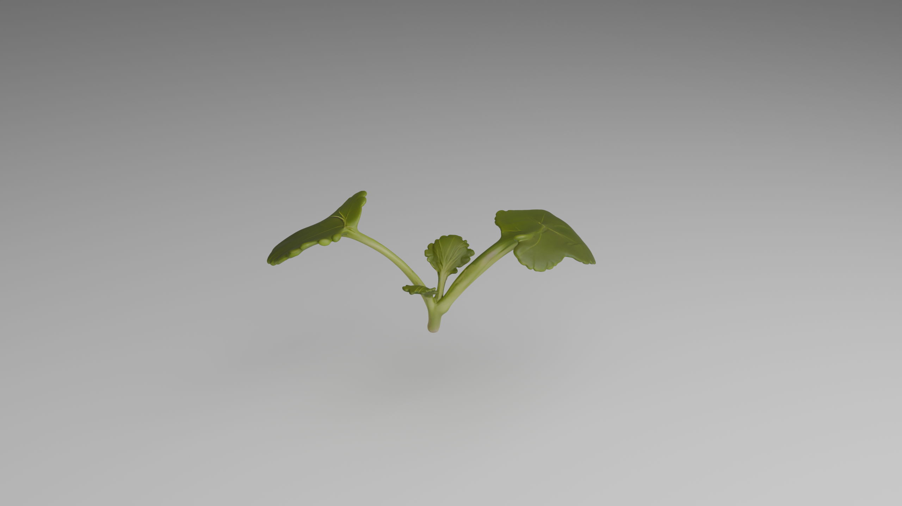
  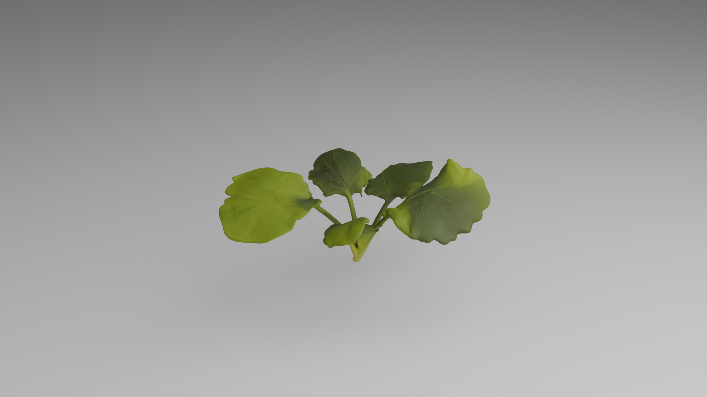

### BBCH 20–29: Rosette and Side Shoot Formation

  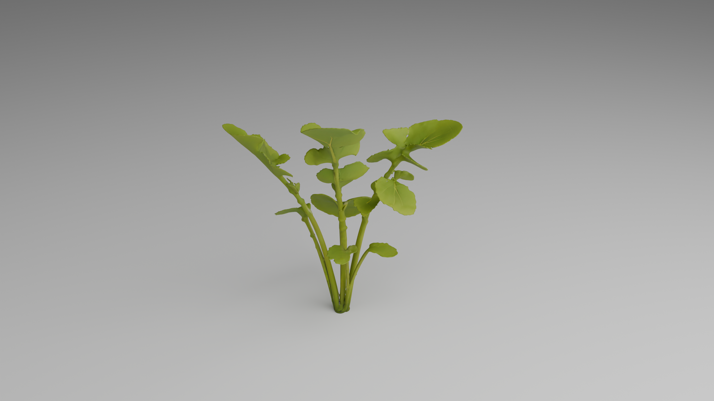
  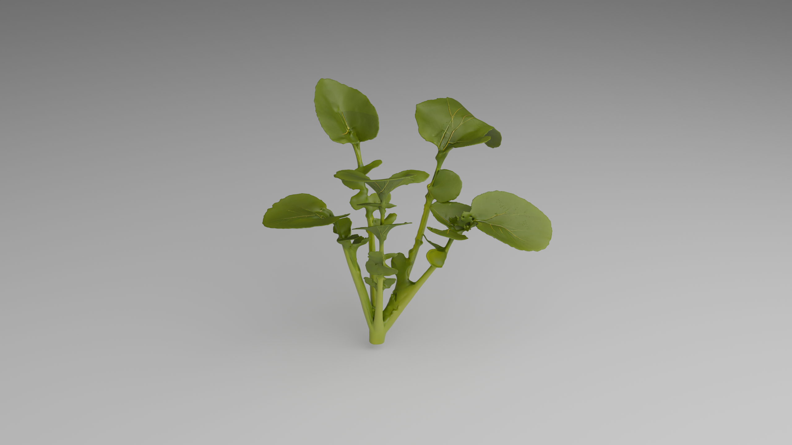

### BBCH 30–39: Stem Elongation

  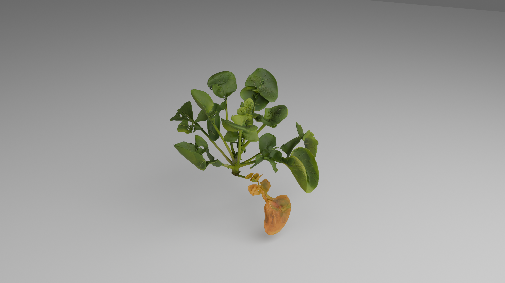
  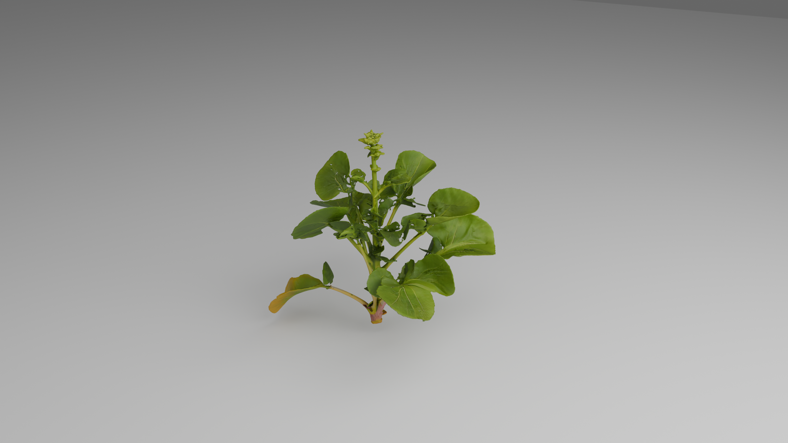

### BBCH 50–59: Bud and Inflorescence Development

  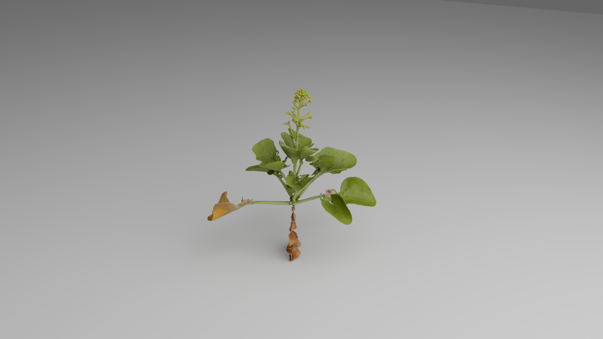
  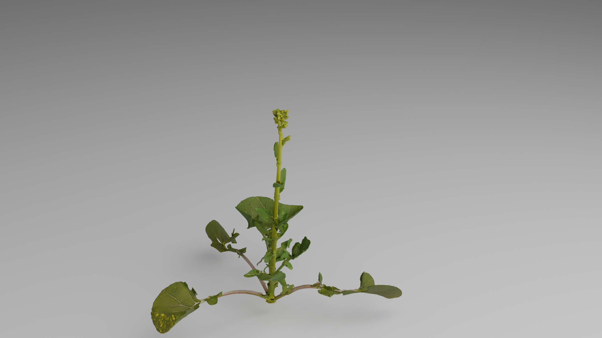

### BBCH 60–69: Flowering

  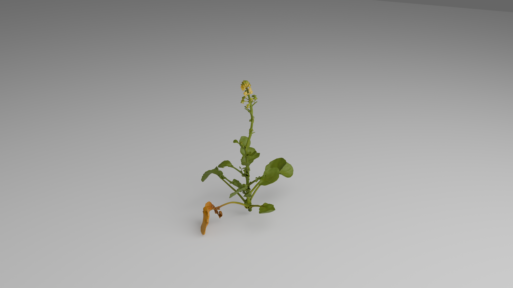
  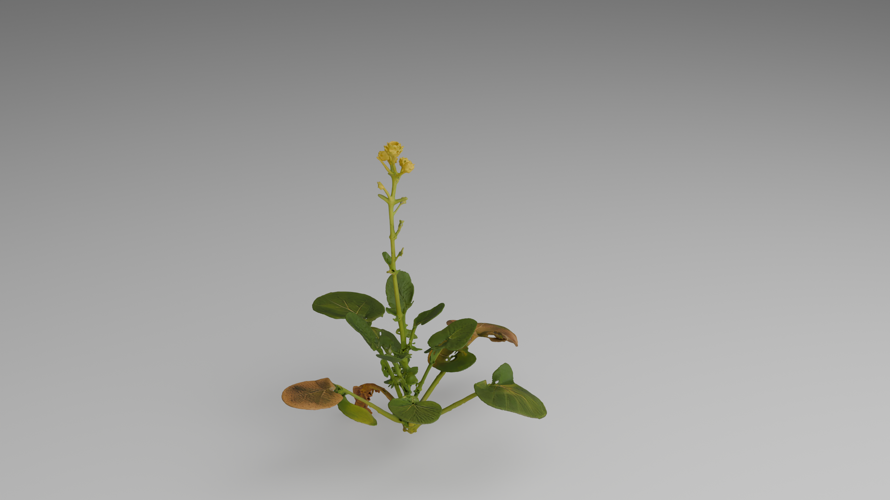

### BBCH 70–79: Pod Development

  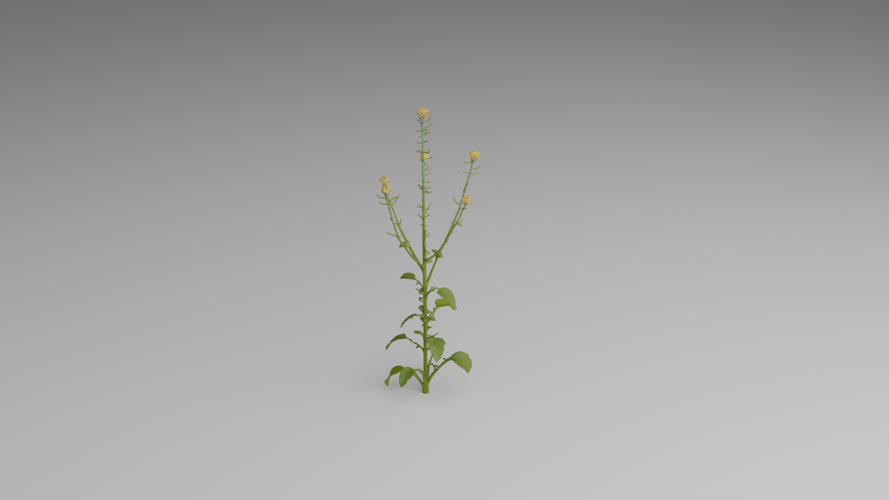
  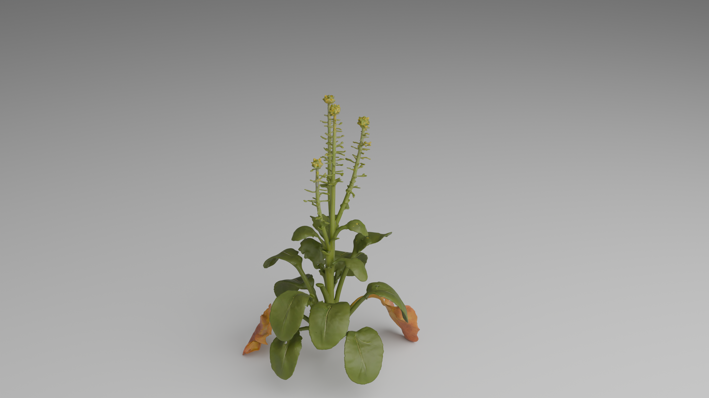

### BBCH 80–89: Ripening and Maturity

  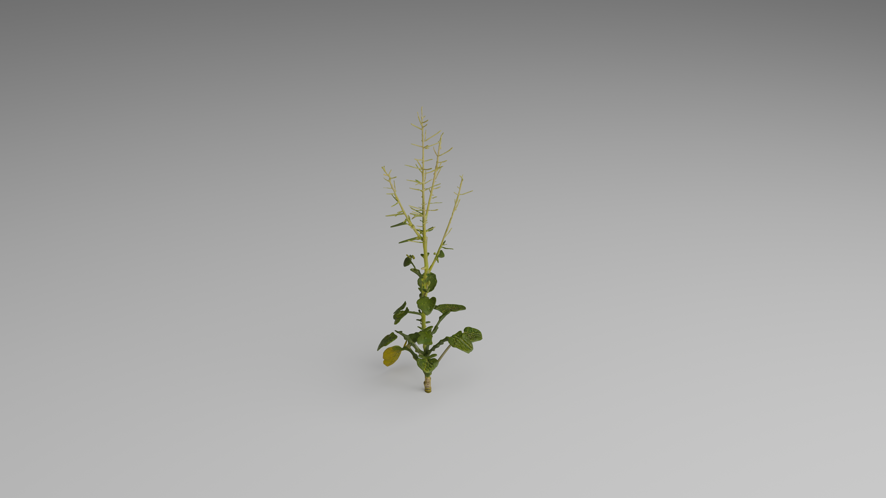
  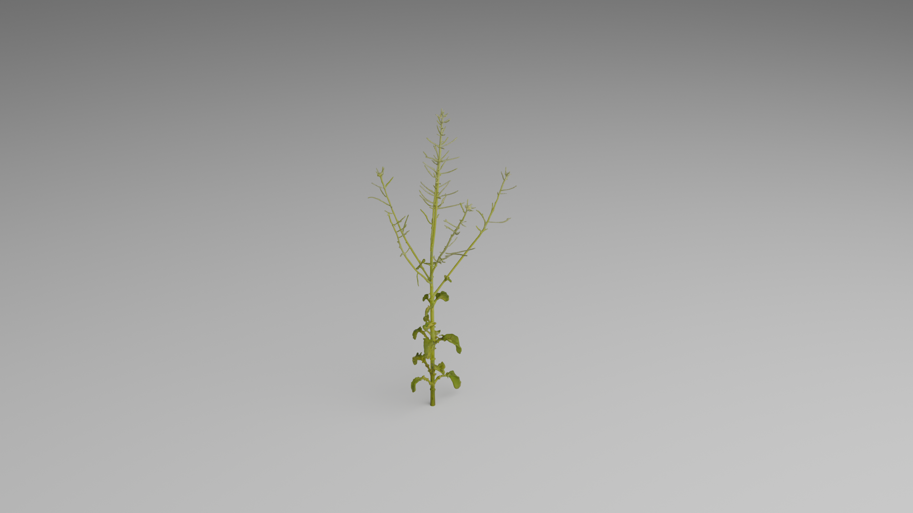

## Repository Organization

The representative images are organized by BBCH growth stage.

| Folder | BBCH range | Developmental stage |
|---|---|---|
| `01_BBCH10-19_Seedling` | BBCH 10–19 | Seedling and leaf development |
| `02_BBCH20-29_Rosette` | BBCH 20–29 | Rosette development |
| `03_BBCH30-39_Stem_elongation` | BBCH 30–39 | Stem elongation |
| `04_BBCH50-59_Bud` | BBCH 50–59 | Bud and inflorescence development |
| `05_BBCH60-69_Flowering` | BBCH 60–69 | Flowering |
| `06_BBCH70-79_Pod` | BBCH 70–79 | Pod development |
| `07_BBCH80-89_Maturity` | BBCH 80–89 | Ripening and maturity |

The complete `.blend` files are distributed through Zenodo. The folders listed above organize the representative images in this GitHub repository.

## Model Characteristics

The digital plant models represent above-ground morphological structures, including:

- Leaf morphology
- Stem architecture
- Branching structure
- Bud and inflorescence characteristics
- Flowering characteristics
- Pod morphology
- Growth-stage-specific plant architecture

The Blender files also include materials and rendering settings.

## Potential Applications

The dataset may support:

- Digital plant modeling
- Three-dimensional crop visualization
- Rapeseed growth-stage analysis
- Plant phenotyping research
- Crop growth simulation
- Computer vision and agricultural artificial intelligence
- Agricultural teaching and scientific communication

## Citation

If you use version 2.0 of this dataset, please cite:

Yuan, Y. (2026). *Rapeseed Blender Models: A Dataset of 220 Three-Dimensional Digital Plant Models Across Selected BBCH Growth Stages* (Version 2.0) [Data set]. Zenodo. https://doi.org/10.5281/zenodo.23408178

If you use another version, cite the DOI corresponding to that version.

## License

This dataset is released under the [Creative Commons Attribution 4.0 International License (CC BY 4.0)](https://creativecommons.org/licenses/by/4.0/).

You may share and adapt the dataset under the terms of this license. Please provide appropriate credit, link to the license, and indicate whether changes were made.

## Author

**Yapeng Yuan**

Graduate Student  
College of Agronomy and Biotechnology  
Southwest University

## Research Background

This dataset was developed as part of a research project on digital plant modeling and growth visualization of rapeseed (*Brassica napus* L.).

The project aims to construct digital representations of rapeseed plants at selected developmental stages and provide model resources for agricultural visualization, digital phenotyping, and crop growth research.

## Contact

For questions, feedback, or reports of missing or incorrect files, please open an issue in this GitHub repository:

[GitHub Issues](https://github.com/yuanyp9-eng/rapeseed-blender-models/issues)
